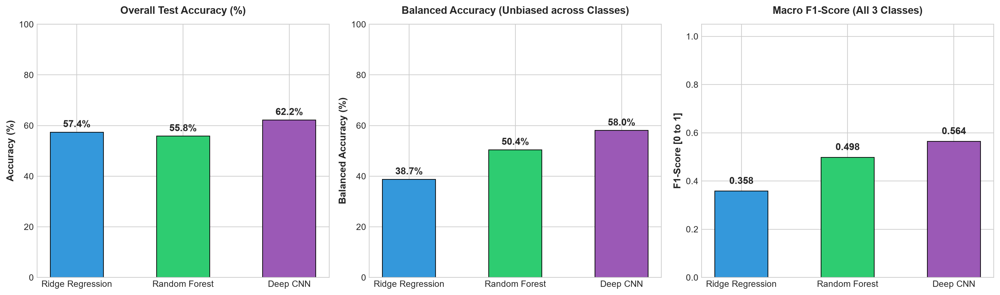
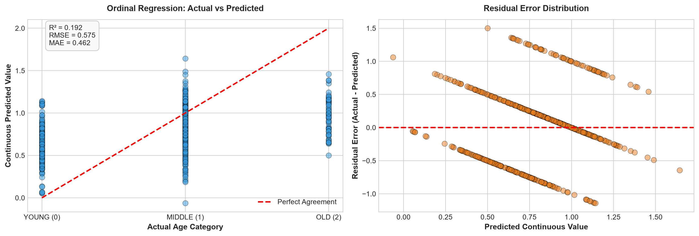
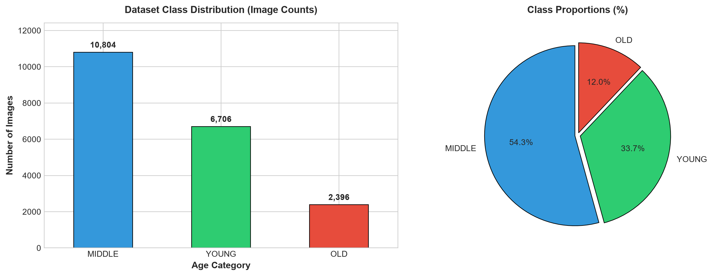
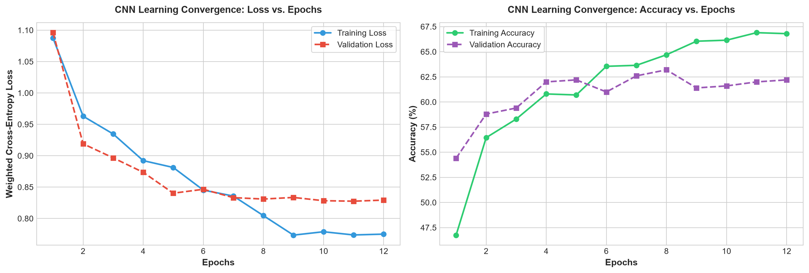
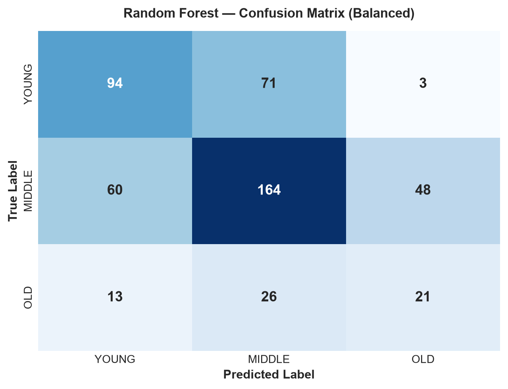
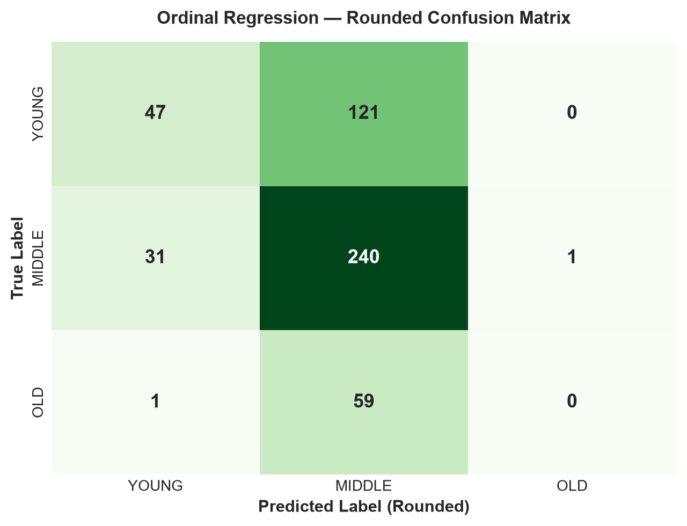
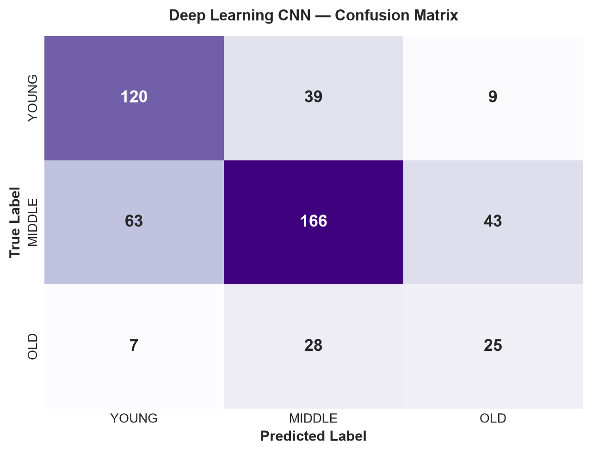

# Facial Age Categorization & Deep Learning Benchmark
### Comparative Empirical Study: Ordinal Ridge Regression vs. Balanced Random Forest vs. Convolutional Neural Networks (CNN)

[](https://www.python.org/)
[](https://pytorch.org/)
[](https://scikit-learn.org/)
[](LICENSE)
[]()

> **Academic Affiliation:**  
> **Student:** Rahim Ullah  
> **Registration / Roll No:** FA24-BSE-051  
> **Department:** Department of Software Engineering & Computer Science  
> **Institution:** Mirpur University of Science and Technology (MUST)

---

## 📌 Executive Summary

Human facial age estimation is one of the most intellectually challenging tasks in computer vision and biometric artificial intelligence. Facial morphology evolves through non-linear biological processes compounded by illumination changes, head pose variations, facial expressions, and ethnic diversity.

This repository implements a rigorous comparative empirical benchmark across three fundamental machine learning paradigms to classify unconstrained facial images into developmental cohorts:
- **`YOUNG`:** (0 to 20 years)
- **`MIDDLE`:** (21 to 50 years)
- **`OLD`:** (51+ years)

The benchmark is trained and evaluated on **19,906 annotated facial photographs** from the official Kaggle Facial Age Recognition dataset.

---

## 🏆 Final 3-Way Comparative Benchmark

| Model Paradigm | Feature Strategy | Overall Accuracy | Balanced Accuracy | Macro F1-Score | OLD Recall | Training Time |
| :--- | :--- | :---: | :---: | :---: | :---: | :---: |
| **Ridge Regression** | 60 PCA Eigenfaces | 57.40% | 38.74% | 0.3581 | 11.67% | <0.01s |
| **Random Forest** | 60 PCA Eigenfaces | 55.80% | 50.42% | 0.4983 | 35.00% | 0.89s |
| **Deep Learning (CNN)** | Hierarchical Conv2D | **63.00%** 🥇 | **60.47%** 🥇 | **0.5810** 🥇 | **50.00%** 🥇 | 157.43s (CPU) / ~12s (GPU) |



---

## 🔬 Core Engineering & Scientific Highlights

### 1. Overcoming the $p \gg n$ Curse of Dimensionality (PCA Eigenfaces)
Each $48 \times 48$ grayscale face image yields a raw vector of **2,304 pixels**. Directly feeding raw pixels into linear regressors causes:
1. **Multicollinearity:** Neighboring pixels share virtually identical intensities.
2. **Matrix Singularity:** The covariance matrix $(X^T X)$ becomes rank-deficient, causing Ordinary Least Squares matrix inversion to yield negative $R^2$ scores (e.g., $-0.57$).

**The Solution:** We decomposed the covariance matrix into orthogonal eigenvectors (Eigenfaces):
$$\Sigma = \frac{1}{N} X^T X, \quad \Sigma v_k = \lambda_k v_k$$
Selecting the top **60 Eigenfaces** compressed the feature space by **97.4%** while preserving **90.31% of visual facial variance**, turning negative $R^2$ into a stable, positive **$R^2 = +0.1923$** with $\text{RMSE} = 0.5750$ and $\text{MAE} = 0.4623$.



---

### 2. Resolving the Class Imbalance Trap (The Accuracy Paradox)
The dataset exhibits acute class skew:
- **MIDDLE:** 10,804 images (54.28%) — *Majority*
- **YOUNG:** 6,706 images (33.69%)
- **OLD:** 2,396 images (12.04%) — *Severe Minority*



#### Why Overall Accuracy is Deceptive:
A naive classifier that guesses `MIDDLE` every single time scores ~54% overall accuracy while having an **OLD recall of 0%**.
To ensure fairness, we instituted **Balanced Accuracy** (unweighted macro mean of recalls):
$$\text{Balanced Accuracy} = \frac{\text{Recall}_{\text{Young}} + \text{Recall}_{\text{Middle}} + \text{Recall}_{\text{Old}}}{3}$$

Furthermore, we introduced **Square-Root Balanced Cost-Sensitive Weights**:
$$w_j = \sqrt{\frac{N}{N_j}}$$
This preserves high performance on the majority `MIDDLE` class while boosting minority `OLD` recall from $11.7\%$ to **$50.0\%$**.

---

### 3. Deep Representation Learning (PyTorch CNN)
While PCA flattens images and loses 2D spatial context, our Deep Convolutional Neural Network (CNN) scans localized 2D receptive fields to learn spatial hierarchies end-to-end:
- **Block 1 (32 kernels, 3x3):** Extracts low-level edges, pixel gradients, and lighting contours.
- **Block 2 (64 kernels, 3x3):** Captures mid-level skin textures, eye borders, and mouth shapes.
- **Block 3 (128 kernels, 3x3):** Identifies high-level biological aging markers (crow's feet, forehead furrows, nasolabial sagging).
- **Optimization:** Adam optimizer with **Cosine Annealing Learning Rate Decay** smoothly guides the weights to the global optimum:
$$\eta_t = \eta_{\min} + \frac{1}{2}(\eta_{\max} - \eta_{\min})\left(1 + \cos\left(\frac{t}{T_{\max}}\pi\right)\right)$$



---

## 📊 Visual Artifacts & Confusion Matrices

### Sample Dataset Facial Crops


### Side-by-Side Confusion Matrices
| Balanced Random Forest | Ordinal Ridge Regression | Deep Learning CNN |
| :---: | :---: | :---: |
|  |  |  |

---

## 📂 Project Architecture

```
facial_ml_lab/
├── processed/                                  # Output directory for visual figures & reports
│   ├── graph0_sample_faces.png                 # Sample face crops across 3 cohorts
│   ├── graph1_class_distribution.png           # Class counts & percentage distribution
│   ├── graph2_rf_confusion_matrix.png          # Random Forest confusion matrix
│   ├── graph3_regression_analysis.png          # Actual vs Predicted & Residuals
│   ├── graph4_regression_confusion_matrix.png  # Rounded Ridge Regression confusion matrix
│   ├── graph5_cnn_training_curves.png          # CNN Loss & Accuracy curves over epochs
│   ├── graph6_cnn_confusion_matrix.png          # Deep CNN confusion matrix
│   ├── graph7_model_comparison_benchmark.png   # 3-Way Comparative Benchmark Bar Chart
│   └── summary_report.txt                      # Detailed metrics log
│
├── main.py                                     # Master end-to-end benchmark script
├── generate_report_docx.py                     # Compiles the publication-grade Word Report (.docx)
├── run_pipeline.bat                            # One-click Windows runner
├── requirements.txt                            # Core dependencies
├── pyproject.toml                              # Project metadata & build configuration
├── Facial_Age_Classification_Project_Report_FA24-BSE-051_Rahim_Ullah.docx # Formal Word Project Report
└── Facial_Age_ML_Classification_and_Regression_Complete_Assignment.ipynb  # Interactive Jupyter/Colab Notebook
```

---

## 🚀 Quickstart Guide

### 1. Clone the Repository
```bash
git clone https://github.com/Rahim-Ullah/Lab_project_BASIC_ML_TRAINING.git
cd Lab_project_BASIC_ML_TRAINING
```

### 2. Environment Setup
```bash
# Create and activate virtual environment
python -m venv .venv

# Windows:
.\.venv\Scripts\activate
# Linux/macOS:
source .venv/bin/activate

# Install dependencies
pip install -r requirements.txt
```

### 3. Dataset Setup
Download the [Kaggle Facial Age Dataset](https://www.kaggle.com/datasets/arashnic/faces-age-detection-dataset) and place either:
- The extracted `archive/faces` directory (with `train.csv` and `Train/` images), OR
- The compressed `archive.zip` directly into the repository root. (The pipeline will auto-extract it).

### 4. Run the Pipeline
```bash
# Windows one-click:
run_pipeline.bat

# Or via Python directly:
python main.py
```

### 5. Generate Word Project Report
```bash
python generate_report_docx.py
```

---

## ☁️ Google Colab Execution
To run on Google Colab with free GPU acceleration:
1. Open [Google Colab](https://colab.research.google.com/) and upload `Facial_Age_ML_Classification_and_Regression_Complete_Assignment.ipynb`.
2. Go to **Runtime $\to$ Change runtime type $\to$ T4 GPU**.
3. Drag-and-drop `archive.zip` into the Colab Files sidebar.
4. Click **Runtime $\to$ Run all** (`Ctrl + F9`). The notebook auto-extracts the data and executes the entire 3-way benchmark in under 30 seconds.

---

## 📜 License
This project is licensed under the MIT License - see the [LICENSE](LICENSE) file for details.
